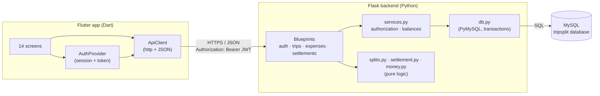
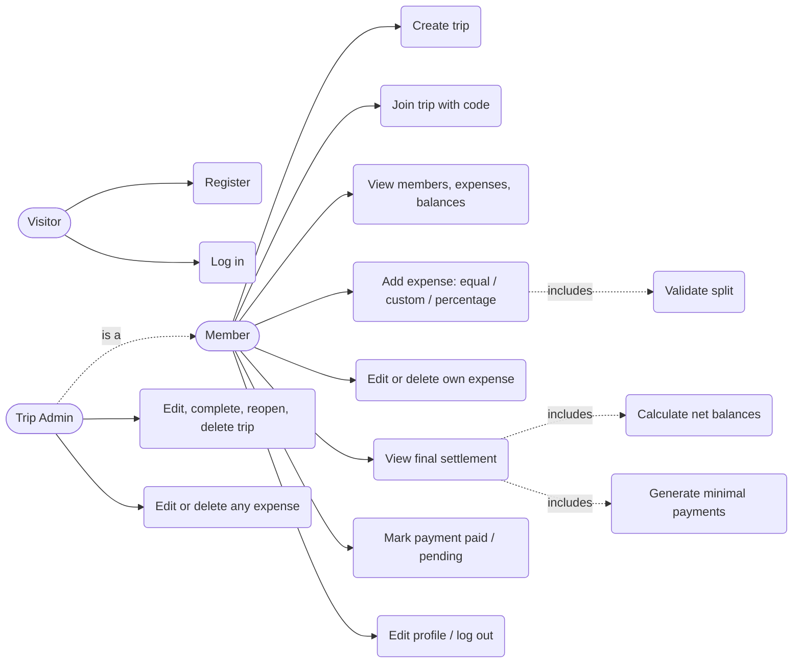
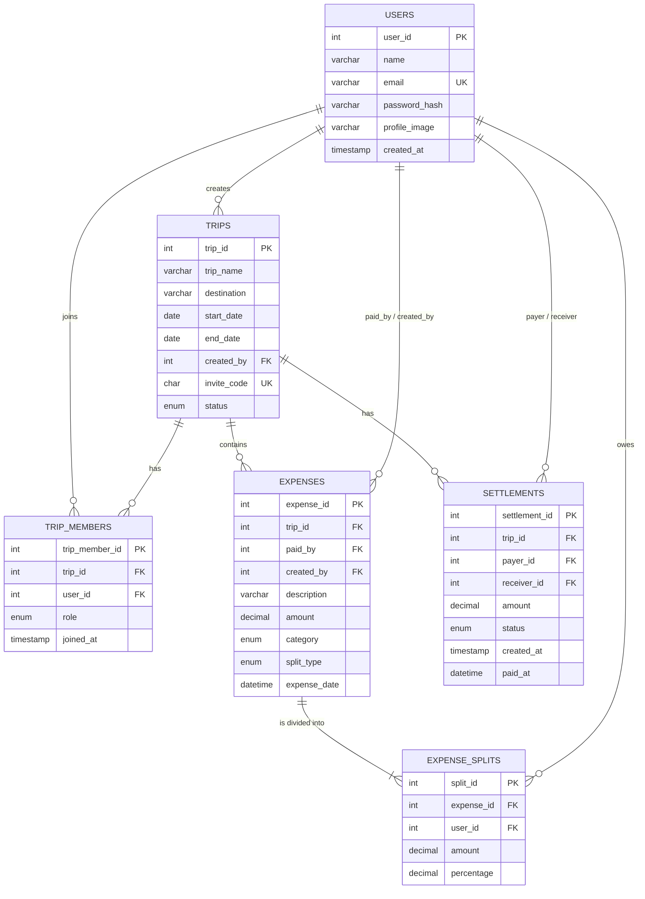
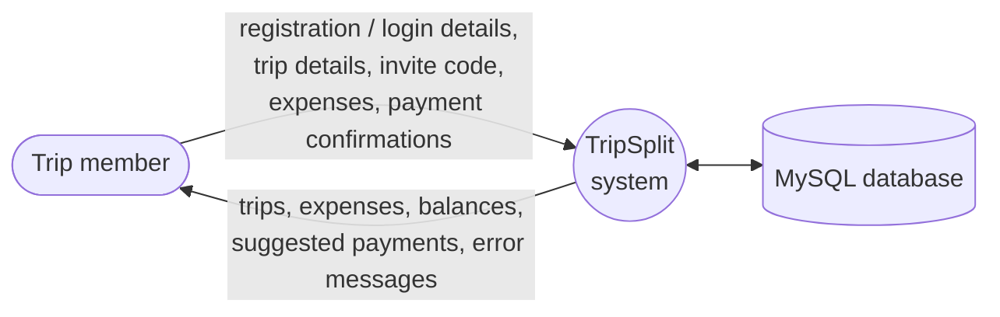
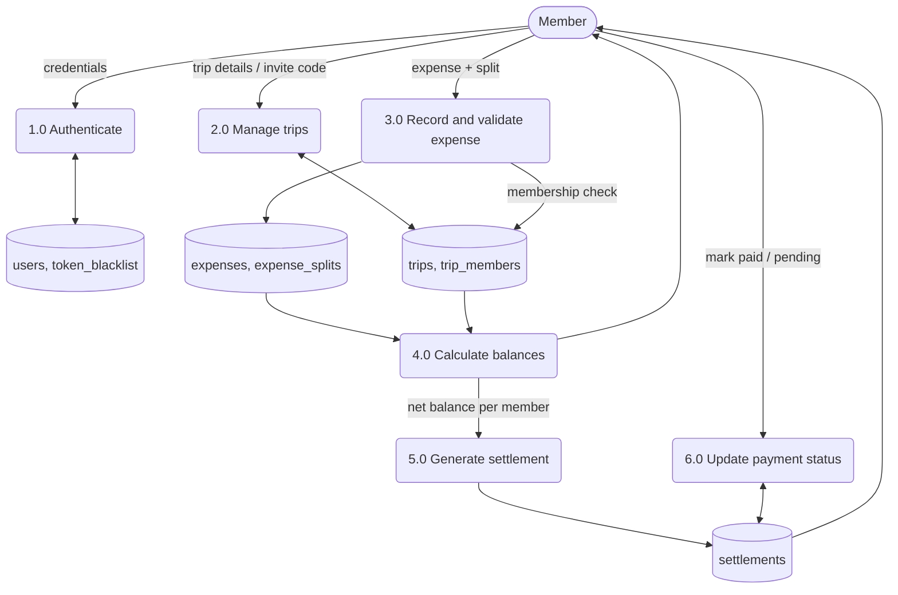
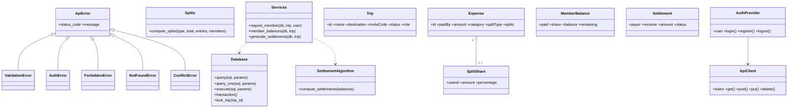

# TripSplit — Group Trip Expense & Settlement Application

**Mini-project report: Database Management Systems + Software Engineering**
Stack: Flutter · Flask (Python) · MySQL · pytest

> Diagrams are written in [Mermaid](https://mermaid.js.org). They render automatically on GitHub, in VS Code (Markdown Preview Mermaid Support extension) and at <https://mermaid.live>, where each one can be exported as PNG/SVG for the printed report.

---

## Table of contents
1. Requirement analysis
2. System design
3. Implementation
4. Testing
5. Deployment
6. Maintenance and future scope
7. Appendix A — REST API reference
8. Appendix B — Limitations and what was verified

---

## 1. Requirement analysis

### 1.1 Problem statement
On a group trip different people pay for different things, and each expense is shared by a different subset of the group. Working out the final "who owes whom" by hand is slow and error-prone. TripSplit keeps one shared, central record of every expense for a trip and computes the **smallest set of payments** that settles everybody.

### 1.2 Actors
| Actor | Description |
|---|---|
| Visitor | Not logged in; can register or log in. |
| Member | Logged-in user who belongs to a trip. Can add expenses, view data, mark their own payments. |
| Trip Admin | The member who created the trip. Everything a member can do, plus edit/complete/delete the trip, and edit/delete any expense. |

### 1.3 Functional requirements
| ID | Requirement | Where implemented |
|---|---|---|
| FR-1 | Register, log in, log out, view/edit profile | `routes_auth.py`, screens 2, 3, 14 |
| FR-2 | Create a trip (creator becomes admin; unique invite code generated) | `POST /api/trips` |
| FR-3 | Join a trip with an invite code | `POST /api/trips/join` |
| FR-4 | Many users per trip, one shared dataset | `trip_members` table, membership checks on every endpoint |
| FR-5 | Any member adds an expense: payer, description, amount, category, date | `POST /api/trips/{id}/expenses` |
| FR-6 | Equal, custom-amount and percentage splits with validation | `splits.py` |
| FR-7 | Edit / delete an expense | `PUT/DELETE /api/expenses/{id}` |
| FR-8 | Dashboard: totals, my contribution / share / balance, member summary, per-category spending | `GET /api/trips/{id}`, `/balances`, screen 7 |
| FR-9 | Settlement: net balances first, then a minimal list of payments | `settlement.py`, `POST /api/trips/{id}/settlements/generate` |
| FR-10 | Mark a payment Pending / Paid; keep history in the database | `PUT /api/settlements/{id}/pay`, `settlements` table |
| FR-11 | Validation of all inputs (see 1.5) | `money.py`, `splits.py`, route modules, DB constraints |
| FR-12 | Authorization: users only see/modify trips and data they are entitled to | `services.require_member`, `_require_editor`, `_require_admin` |

### 1.4 Non-functional requirements
| ID | Requirement | How it is met |
|---|---|---|
| NFR-1 Correctness | Money must never be off by a paisa | All calculations in integer paise; `DECIMAL(12,2)` in MySQL; remainders distributed deterministically; balances provably sum to zero (tested) |
| NFR-2 Integrity | No orphan or inconsistent rows | Foreign keys, UNIQUE/CHECK/NOT NULL constraints, transactions for multi-row writes |
| NFR-3 Security | Passwords hashed, access controlled | Werkzeug salted hashes, JWT bearer tokens with logout revocation, per-endpoint authorization, parameterised SQL |
| NFR-4 Usability | Clean, simple mobile UI | Material 3, 14 focused screens, live validation on the split form |
| NFR-5 Maintainability | Clear separation of concerns | Routes / services / pure logic (splits, settlement, money) / DB layer |
| NFR-6 Testability | Core logic testable without a UI or DB server | Pure functions + SQLite twin schema for API tests |
| NFR-7 Portability | Runs locally with free tools | MySQL, Python, Flutter; configuration via environment variables |

### 1.5 Validation rules (from the brief) and where they are enforced
| Rule | Enforced in |
|---|---|
| Invalid email / empty fields | API (`EMAIL_RE`, `require_text`) and Flutter validators |
| Duplicate email | API pre-check (409) **and** `UNIQUE uq_users_email` |
| Incorrect login | API returns 401 with the same message for unknown email / wrong password |
| Zero or negative amount | `money.parse_amount` **and** `CHECK chk_expenses_amount_positive` |
| Invalid split amount / amounts ≠ expense total | `splits._custom` |
| Percentages ≠ 100 | `splits._percentage` |
| Invalid trip code | `POST /trips/join` → 404 |
| Adding an expense to a trip you have not joined | `require_member` → 403 |
| Duplicate trip membership | API pre-check (409) **and** `UNIQUE uq_trip_members_trip_user` |
| Payer / participants must belong to the trip | `splits._participant_ids`, `_parse_expense` |

---

## 2. System design

### 2.1 Architecture

All members talk to the same backend and database, so an expense added by one member is immediately visible to every other member.

### 2.2 Use case diagram


### 2.3 Entity–relationship diagram

`TRIP_MEMBERS` is the junction table that resolves the many-to-many relationship between users and trips; `UNIQUE (trip_id, user_id)` prevents duplicate membership. A seventh table, `token_blacklist`, stores revoked JWT ids (logout) and has no relationships.

### 2.4 Database schema and normalisation
The full DDL is in `database/schema.sql`. Summary of constraints:

| Table | Keys | Other constraints |
|---|---|---|
| `users` | PK `user_id` | `UNIQUE(email)`, `CHECK(name not blank)` |
| `trips` | PK `trip_id`; FK `created_by → users` (RESTRICT) | `UNIQUE(invite_code)`, `CHECK(end_date >= start_date)` |
| `trip_members` | PK; FKs to trips (CASCADE) and users (CASCADE) | `UNIQUE(trip_id, user_id)` |
| `expenses` | PK; FKs to trips (CASCADE), users (`paid_by`, `created_by`, RESTRICT) | `CHECK(amount > 0)`, category and split_type ENUMs, index `(trip_id, expense_date)` |
| `expense_splits` | PK; FKs to expenses (CASCADE), users (RESTRICT) | `UNIQUE(expense_id, user_id)`, `CHECK(amount >= 0)`, `CHECK(percentage in (0,100])` |
| `settlements` | PK; FKs to trips (CASCADE), users `payer_id`, `receiver_id` (RESTRICT) | `CHECK(amount > 0)`, `CHECK(payer_id <> receiver_id)`, `CHECK` that `paid_at` is set exactly when status is `paid`, index `(trip_id, status)` |

**Normalisation.** 1NF: every column is atomic (no lists; the participants of an expense are rows of `expense_splits`). 2NF: every non-key attribute depends on the whole key (tables use single-column surrogate keys; the `(trip_id, user_id)` and `(expense_id, user_id)` pairs are unique alternate keys). 3NF: no transitive dependencies — a user's name lives only in `users`, trip data only in `trips`; totals and balances are **not stored** but derived by the views below, so they can never drift out of sync with the expenses.

**Views.**
* `v_member_balances` — per trip member: `total_paid`, `total_share`, `settled_out`, `settled_in` (all via correlated subqueries). The API computes `balance = paid − share` and `remaining = balance + settled_out − settled_in` from it.
* `v_trip_totals` — member count, expense count and total spending per trip.

**Transactions.** Creating a trip (trip + admin membership), adding / editing / deleting an expense (expense + splits + invalidating pending settlements) and generating settlements run inside one transaction (`db.transaction()`), with a `SELECT … FOR UPDATE` row lock on the trip so two members writing at once cannot interleave.

Example queries for INSERT, SELECT, UPDATE, DELETE, JOIN, GROUP BY, HAVING, aggregates, subqueries (scalar, IN, EXISTS, correlated), views, transactions and constraint violations are in `database/sample_queries.sql`.

### 2.5 Data flow diagrams
**Level 0 (context diagram)**


**Level 1**


### 2.6 Class diagram

(Backend classes above the line are Python; `Trip` … `AuthProvider` are the Dart classes in `frontend/lib`.)

### 2.7 Screens
| # | Screen | File |
|---|---|---|
| 1 | Splash (restores saved session) | `splash_screen.dart` |
| 2 | Login | `login_screen.dart` |
| 3 | Registration | `register_screen.dart` |
| 4 | Home / My Trips | `home_screen.dart` |
| 5 | Create Trip | `create_trip_screen.dart` |
| 6 | Join Trip | `join_trip_screen.dart` |
| 7 | Trip Dashboard | `trip_dashboard_screen.dart` |
| 8 | Members | `members_screen.dart` |
| 9 | Expenses (with category filter) | `expenses_screen.dart` |
| 10 | Add / edit expense | `add_expense_screen.dart` |
| 11 | Expense details | `expense_details_screen.dart` |
| 12 | Balances | `balances_screen.dart` |
| 13 | Final settlement | `settlement_screen.dart` |
| 14 | Profile | `profile_screen.dart` |

---

## 3. Implementation

### 3.1 Backend (`backend/`)
| Module | Responsibility |
|---|---|
| `app.py` | Application factory, CORS, JSON provider (Decimal → number, dates → ISO), central error handlers |
| `config.py` | Settings from environment variables |
| `db.py` | PyMySQL connection per request, `query / execute`, `transaction()` context manager |
| `auth.py` | JWT creation, `@login_required` (checks signature, expiry, revocation list, user still exists) |
| `routes_auth.py` | register, login, logout, profile |
| `routes_trips.py` | create/list/join/detail/update/delete trip, members, balances |
| `routes_expenses.py` | add/list/get/update/delete expense |
| `routes_settlements.py` | list, generate, mark paid |
| `services.py` | Request parsing, membership/admin checks, balances from the view, settlement persistence |
| `money.py` | Parsing and exact paise arithmetic |
| `splits.py` | Equal / custom / percentage split validation and calculation |
| `settlement.py` | The settlement algorithm |

**Money handling.** Requests are parsed with `Decimal` (never `float` arithmetic), limited to 2 decimal places, converted to integer paise, and stored as `DECIMAL(12,2)`.

**Splits.**
* *Equal* — `total ÷ n` in paise; the remainder paise go one each to the first participants (₹100 ÷ 3 → 33.34 + 33.33 + 33.33).
* *Custom* — each amount > 0, participants unique and in the trip, sum must equal the expense exactly.
* *Percentage* — each in (0, 100], two decimals, sum exactly 100; amounts are computed with the largest-remainder method so they always add up to the total.

**Settlement algorithm** (`settlement.py`).
1. Net balance per member = `paid − share − (settlements already paid out) + (settlements already received)`; positive = creditor, negative = debtor. The balances of a trip always sum to 0.
2. Individual expenses are never turned into repayments — only these net balances are used.
3. The minimum possible number of payments equals `(members with a non-zero balance) − (maximum number of disjoint groups whose balances sum to zero)`, because a zero-sum group of *k* people can be settled with *k − 1* payments and no fewer. The code finds that maximum with a bitmask dynamic programme (O(n·2ⁿ), used for up to 14 people with a non-zero balance), so the result is **provably minimal** for normal trips.
4. Inside each zero-sum group the largest debtor pays the largest creditor (max-heaps). For groups larger than 14 the exact search is skipped and a greedy method is used: still always correct, at most *n − 1* payments, but not guaranteed to be the absolute minimum.

Worked example from the brief — Rahul owes 1000, Sneha 500, Ishani is owed 1200, Aditi 300:
`Rahul → Ishani ₹1000`, `Sneha → Ishani ₹200`, `Sneha → Aditi ₹300` (3 payments; automated test TC-SET-01).

A case where plain greedy is *not* optimal (balances −8, +6, −2, +3, +4, −3): greedy needs 5 payments, the exact search finds 4 (TC-ALG-06).

**Settlement life-cycle.** Pending settlements are a *derived suggestion*: adding, editing or deleting an expense deletes the pending ones (the screen then shows "not calculated yet"). Payments already marked **paid** are history and are kept; they are subtracted from the balances, so recalculating after a late expense only asks for the extra money still owed.

**Security.**
* Passwords: Werkzeug salted hash (`scrypt`/`pbkdf2`), never stored or returned in plain text; minimum 6 characters.
* Authentication: JWT (HS256) in the `Authorization: Bearer` header; logout stores the token id in `token_blacklist`.
* Authorization: every trip endpoint calls `require_member` (403 otherwise). Expense edit/delete → creator or admin. Trip edit/delete → admin. Marking a settlement → payer, receiver or admin.
* SQL injection: every query uses `%s` parameters; the few places that assemble SQL (the optional expense filters, the `IN (subquery)` helper) only concatenate fixed fragments written in the code, never user input (test TC-SEC-02).
* A completed trip is read-only (expenses cannot be changed, nobody can join).
* Set a strong `SECRET_KEY` in production (the default is for development only).

### 3.2 Frontend (`frontend/lib/`)
* `main.dart` — Material 3 theme, `Provider` for the session, global handler that returns to Login when the server answers 401.
* `services/api_client.dart` — one place for HTTP, JSON, timeouts and error messages (`ApiException`).
* `services/auth_provider.dart` — login / register / logout, token persisted with `shared_preferences`, session restore on start-up.
* `models/models.dart` — typed Dart classes parsed from the API's JSON.
* `utils/validators.dart` — client-side form validation mirroring the server rules.
* `widgets/common.dart` — shared widgets (async loading/error/retry view, empty state, chips) and ₹ formatting with Indian digit grouping.
* `screens/` — the 14 screens. The Add Expense form shows the remaining amount (custom) or running total (percentage) live and blocks submission until the split is valid; the server validates again.

### 3.3 Database
See 2.3–2.4 and `database/schema.sql`, `database/sample_queries.sql`.

---

## 4. Testing

### 4.1 Strategy
| Level | Tool | What |
|---|---|---|
| Unit | pytest | `money`, `splits`, `settlement` (pure functions; includes 300 randomised trips checked against an independent brute-force minimum) |
| API / integration | pytest + Flask test client | every endpoint, positive and negative, authorization, DB constraints, cascade deletes |
| UI | Manual (section B of `TEST_PLAN.md`) + `flutter test` for validators | screens run on an emulator/phone |

The brief allows "Selenium or an appropriate automation framework where applicable". Selenium drives web browsers and cannot drive a native Flutter app, so the automation framework used is **pytest** for the backend. (If a Flutter *web* build is produced, Selenium could be pointed at it; Flutter's own `integration_test` package is the usual tool for automated mobile UI tests.)

### 4.2 Test plan and results
The complete table (Test Case ID, Scenario, Input, Expected Result, Actual Result, Status) is in **`TEST_PLAN.md`**. It is generated by `docs/build_test_plan.py`, which runs the suite and records the real outcome of each case, so the "Actual Result" and "Status" columns come from an actual run rather than being typed in.

Coverage of the areas required by the brief: registration, login, trip creation, joining a trip, adding expenses, equal / custom / percentage splitting, invalid expenses, balance calculation, settlement generation, marking a settlement as paid, unauthorized access — each with positive and negative cases.

### 4.3 How to run
```bash
cd backend
python -m pytest -q                  # all tests
python -m pytest tests/test_settlement.py -v
cd ../frontend && flutter test       # validator unit tests
```

---

## 5. Deployment

### 5.1 Run locally
See `README.md`: create the database from `database/schema.sql`, start the Flask server, run the Flutter app with `--dart-define=API_BASE_URL=…` pointing at it.

| Where the app runs | API address to use |
|---|---|
| Android emulator | `http://10.0.2.2:5000` (default) |
| iOS simulator / desktop | `http://127.0.0.1:5000` |
| Real phone on the same Wi-Fi | `http://<PC-LAN-IP>:5000` (allow port 5000 through the firewall) |

### 5.2 Configuration (environment variables)
`MYSQL_HOST`, `MYSQL_PORT`, `MYSQL_USER`, `MYSQL_PASSWORD`, `MYSQL_DB`, `SECRET_KEY`, `JWT_EXPIRY_HOURS`.

### 5.3 Deploying for real use
1. Run MySQL 8.0.16+ (managed service or VM); create a dedicated DB user with rights only on `tripsplit`.
2. Run the API with a production WSGI server instead of `python app.py`, e.g. `pip install gunicorn && gunicorn -w 4 -b 0.0.0.0:8000 "app:create_app()"`, behind an HTTPS reverse proxy (nginx / a cloud load balancer). Set a long random `SECRET_KEY`. Do not enable Flask debug mode.
3. Build the app with the production URL: `flutter build apk --dart-define=API_BASE_URL=https://api.example.com`. Plain-HTTP and the cleartext Android flag are for development only.

---

## 6. Maintenance and future scope

**Maintenance.** Keep `schema.sql` under version control and add numbered migration scripts for every later change; run the test suite before each release; rotate `SECRET_KEY` only with the understanding that it logs everyone out; purge expired rows from `token_blacklist` (done on each logout); back up the database regularly.

**Future scope (not part of the initial mini-project):** receipt/image upload · currency conversion and multi-currency trips · push notifications · real-time updates (WebSockets / polling) · offline expense recording with sync · PDF/CSV export · spending analytics charts · UPI payment links and payment-gateway integration · password reset by e-mail · removing members / leaving a trip · refresh tokens.

---

## 7. Appendix A — REST API reference
All bodies are JSON. Protected endpoints need `Authorization: Bearer <token>`. Errors have the form `{"error": "message"}` (validation errors may add `"details"`).

| Method | Path | Description | Success | Errors |
|---|---|---|---|---|
| POST | `/api/register` | `{name, email, password}` → `{user, token}` | 201 | 400, 409 |
| POST | `/api/login` | `{email, password}` → `{user, token}` | 200 | 400, 401 |
| POST | `/api/logout` | Revoke current token | 200 | 401 |
| GET / PUT | `/api/profile` | View / edit `{name, profile_image, current_password, new_password}` | 200 | 400, 401 |
| POST | `/api/trips` | `{trip_name, destination, start_date, end_date}` (YYYY-MM-DD) | 201 | 400, 401 |
| GET | `/api/trips` | My trips with member count and total | 200 | 401 |
| POST | `/api/trips/join` | `{invite_code}` | 201 | 400, 404, 409 |
| GET | `/api/trips/{id}` | Dashboard: trip, summary (my paid / share / balance), by-category | 200 | 401, 403, 404 |
| PUT / DELETE | `/api/trips/{id}` | Admin: edit / set `status` active↔completed / delete | 200 | 400, 403, 404 |
| GET | `/api/trips/{id}/members` | Members with roles | 200 | 403 |
| GET | `/api/trips/{id}/balances` | Paid, share, balance, remaining per member | 200 | 403 |
| POST | `/api/trips/{id}/expenses` | Add expense (below) | 201 | 400, 403, 409 |
| GET | `/api/trips/{id}/expenses` | List; filters `?category=` `?paid_by=` | 200 | 400, 403 |
| GET | `/api/expenses/{id}` | One expense with its splits | 200 | 403, 404 |
| PUT | `/api/expenses/{id}` | Replace expense (creator or admin) | 200 | 400, 403, 404, 409 |
| DELETE | `/api/expenses/{id}` | Delete expense (creator or admin) | 200 | 403, 404, 409 |
| GET | `/api/trips/{id}/settlements` | Stored plan + history, `all_settled`, `needs_calculation` | 200 | 403 |
| POST | `/api/trips/{id}/settlements/generate` | (Re)calculate pending payments | 200 | 403, 409 |
| PUT | `/api/settlements/{id}/pay` | Optional `{status: "paid"\|"pending"}` (default paid); payer, receiver or admin | 200 | 400, 403, 404 |
| GET | `/api/health` | Liveness check | 200 | — |

**Add-expense body**
```json
{
  "description": "Dinner", "amount": 3600, "category": "Food",
  "paid_by": 2, "expense_date": "2026-12-11T20:30:00",
  "split_type": "equal",
  "splits": [{"user_id": 1}, {"user_id": 2}, {"user_id": 3}]
}
```
Custom: `"split_type": "custom", "splits": [{"user_id": 1, "amount": 500}, …]` · Percentage: `"split_type": "percentage", "splits": [{"user_id": 1, "percentage": 20}, …]`.
`paid_by` defaults to the caller; `category` is one of Food, Hotel, Transportation, Activities, Shopping, Tickets, Fuel, Other.

**Example with curl**
```bash
curl -s -X POST http://127.0.0.1:5000/api/login -H "Content-Type: application/json" \
     -d '{"email":"ishani@example.com","password":"demo123"}'
curl -s http://127.0.0.1:5000/api/trips -H "Authorization: Bearer <token>"
```

---

## 8. Appendix B — Limitations and what was verified

Stated plainly so the report does not over-claim:

* **Automated backend tests ran against SQLite, not MySQL.** The API test-suite uses `backend/tests/schema_sqlite.sql`, a hand-maintained twin of `database/schema.sql`, so it runs without a database server. The application SQL is plain parameterised SQL that both engines accept, but MySQL-specific behaviour (CHECK enforcement on 8.0.16+, `SELECT … FOR UPDATE` locking, `DECIMAL` storage, the PyMySQL driver) has **not** been exercised by the automated tests. Before submission, run once on a real MySQL server: load `schema.sql`, run `python seed_demo.py`, then walk through `sample_queries.sql`, and check the balances query returns the numbers shown by the app.
* **The Flutter app has not been compiled or run yet.** The code was written and reviewed against the Flutter APIs but there was no Flutter SDK available to build it, so the 11 manual UI cases in `TEST_PLAN.md` (section B) are still "Pending". Expect to fix small compile or layout issues on the first `flutter run`.
* Money is returned as JSON numbers (e.g. `33.34`), which is exact for 2-decimal rupee values in practice; the server itself never does floating-point arithmetic on money.
* Profile image upload is not implemented (the field exists in the database/API as an optional URL).
* The exact-minimum settlement search is used for up to 14 members with a non-zero balance; beyond that a correct but possibly non-minimal greedy settlement is produced.
